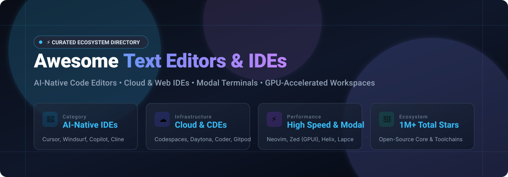

  

# ⚡ Awesome Text Editors & IDE Development  🌟

> 🚀 **The definitive curated directory of SaaS Cloud IDEs, AI-Native Code Editors, Modal Terminal Workspaces, and High-Performance Open-Source Editor Engines.**

**Last updated:** November 2026

Welcome to **Awesome-Text-Editors-IDE-Development** — an authoritative guide tracking premier commercial **SaaS/Hosted platforms** and leading **Open-Source GitHub projects** across the integrated development environment (IDE) and developer tooling industry. Whether you are building custom language tooling, migrating your engineering org to browser-based Cloud Development Environments (CDEs), exploring local agentic AI copilots, or fine-tuning keyboard-driven modal terminal workflows, this collection provides verified feature comparisons, pricing structures, free tier quotas, company valuations, and real-time open-source popularity metrics.

---

## 📑 Table of Contents

- [📊 Sector Overview & Market Dynamics](#-sector-overview--market-dynamics)
- [☁️ SaaS & Hosted Platforms](#️-saas--hosted-platforms)
- [💻 Open-Source GitHub Projects](#-open-source-github-projects)
- [🎯 Selection & Evaluation Criteria](#-selection--evaluation-criteria)
- [💖 Support](#-support)
- [📈 Star History](#-star-history)
- [🤝 How to Contribute](#-how-to-contribute)
- [⚖️ Disclaimer & License](#️-disclaimer--license)

---

## 📊 Sector Overview & Market Dynamics

The global **Integrated Development Environment (IDE) & Developer Tooling** market is valued at approximately **$5.4 Billion in 2026**, projected to exceed **$12.8 Billion by 2033** at a compound annual growth rate (CAGR) of ~13.2%, driven by the massive proliferation of generative AI coding agents and remote cloud development architectures.

The sector exhibits **moderate-to-high concentration with strong category-winner dynamics**: **Microsoft** firmly anchors desktop market share through the VS Code ecosystem and GitHub Codespaces, while **JetBrains** maintains commanding loyalty across mission-critical enterprise polyglot stacks. However, the market is undergoing a structural disruption phase driven by hyper-fast AI-native startups (such as **Anysphere/Cursor** and **Codeium/Windsurf**) and GPU-accelerated low-latency native editors (**Zed**, **Lapce**), resulting in a vibrant, fragmented frontier for agentic developer workflows, local LLM execution, and ephemeral cloud sandboxes.

---

## ☁️ SaaS & Hosted Platforms

The following table benchmarks category-leading commercial text editors and cloud development environments. Entries are sorted in descending order by **Company Valuation / Capitalization / Estimated Scale**.

| 🏢 Platform | 🌟 Focus & Key Capabilities | 💰 Pricing (Starting Tier) | 🎁 Free Tier Limit / Trial Duration | 📈 Valuation / Capitalization / Scale |
| :--- | :--- | :--- | :--- | :--- |
| **[GitHub Codespaces](https://github.com/features/codespaces)** | Cloud-hosted development environments powered by Dev Containers & VS Code Web directly from any Git repo | **$0.18/hour** (Standard 2-core compute instance on Team/Enterprise plans) | **60 core-hours/month & 15 GB storage free** every month for all personal GitHub accounts | **~$3.1 Trillion** *(Subsidiary of Microsoft Corp.)* |
| **[Visual Studio Code for the Web](https://vscode.dev)** | Zero-install browser IDE enabling instant GitHub repository editing, extension hosting & remote tunneling | **Free ($0)** (Core browser platform; Azure remote compute billed on consumption) | **100% Free Forever** (Unlimited client-side GitHub/Azure editing and virtual file trees) | **~$3.1 Trillion** *(Microsoft Corp.)* |
| **[Firebase Studio](https://firebase.google.com)** *(formerly Project IDX)* | Cloud full-stack AI workspace built on Code-OSS with Gemini agents, Nix reproducibility & emulators | **Pay-as-you-go** (Cloud workstation compute pricing on Google Cloud Platform) | **Free Forever** within standard Google Cloud and Firebase free tier compute allocations | **~$2.2 Trillion** *(Alphabet Inc. / Google)* |
| **[JetBrains Fleet & IDEs](https://www.jetbrains.com)** | Polyglot distributed IDE & language tools with local editing, remote SSH/cloud support & smart AST intelligence | **$16.90/month** or **$169/year** (Fleet & All Products Pack starting tiers) | **30-day fully functional free trial**; Fleet currently free in public preview | **~$7 Billion+** *(Estimated enterprise valuation; >$400M annual revenue)* |
| **[Replit](https://replit.com)** | Collaborative cloud IDE & AI software creation suite with Replit Agent, live multiplayer & instant deployments | **$25/month** or **$240/year** (Replit Core tier with AI Agent access) | **Free Starter plan** with public repls, basic workspace compute, and standard AI completions | **~$3.0 Billion** *(Valued at $3B in 2025/2026 funding rounds)* |
| **[Cursor](https://cursor.com)** | AI-native code editor built on VS Code with multi-file Composer agents, semantic indexing & autocomplete | **$20/month** (Pro plan with 500 fast premium requests/mo & unlimited slow requests) | **14-day Pro trial**, plus Free plan with 2,000 completions & 50 slow premium requests/month | **~$2.5 Billion** *(Anysphere valuation via Benchmark/Andreessen Horowitz)* |
| **[Windsurf](https://windsurf.com)** *(by Codeium)* | Autonomous agentic AI IDE with Cascade multi-file context, real-time terminal sync & Supercomplete | **$15/month** or **$120/year** (Pro plan with unlimited premium AI Cascade flows) | **Free Forever plan** with unlimited basic Tab completions & 50 Cascade prompt flows/month | **~$1.25 Billion** *(Codeium valuation following Series C unicorn funding)* |
| **[StackBlitz & Bolt.new](https://stackblitz.com)** | Instant browser IDE powered by WebContainers running Node.js, Vite & Next.js in-browser with zero latency | **$10/month** (Pro tier for unlimited private projects and extra container RAM) | **Free Forever** for unlimited public projects, WebContainers execution, and community sandboxes | **~$700 Million** *(Venture-backed by Greylock, Google Ventures & prominent angels)* |
| **[Gitpod](https://www.gitpod.io)** *(Ona)* | Automated ephemeral cloud development environments & sandboxed AI coding agents orchestrated from Git | **$20/user/month** (Team plan with dedicated workspace infrastructure) | **Free Forever plan** offering 50 hours/month of standardized cloud workspace compute | **~$350 Million** *(Total funding ~$38M+ led by General Catalyst and Pebble Creek)* |
| **[CodeSandbox](https://codesandbox.io)** | Cloud development platform with microVM sandboxes, live branch previews & collaborative web environments | **$18/editor/month** (Pro plan with 16 vCPU microVMs & 500 GB storage) | **Free Forever plan** including unlimited public sandboxes, 20 shared environments, and live collaboration | **~$150 Million** *(Backed by Kleiner Perkins, EQT Ventures & prominent dev angels)* |
| **[Sublime Text & Panic Nova](https://www.sublimetext.com)** | High-speed commercial desktop code editors engineered in C++/Objective-C for ultra-low latency & responsive editing | **$99** perpetual personal license (Sublime Text) / **$99/year** (Panic Nova) | **Indefinite free evaluation trial** with occasional reminder dialog (Sublime Text); **30-day free trial** (Panic Nova) | **~$50 Million** *(Privately held bootstrap software studios; Sublime HQ & Panic Inc.)* |

---

## 💻 Open-Source GitHub Projects

The following table catalogs premier open-source text editors, terminal workspaces, cloud IDE servers, and extensible AI agent harnesses. Entries are sorted in descending order by **GitHub_Stars_Count**.

| 📦 Repository & Project | ⭐ Popularity (Stars) | 📝 Language & Architecture | 🛠️ Core Description & Use Cases |
| :--- | :--- | :--- | :--- |
| **[microsoft/vscode](https://github.com/microsoft/vscode)** |  | TypeScript / Electron | The foundational MIT-licensed open-source core powering the global extension ecosystem, LSP, debug adapters, and modern IDE development. |
| **[neovim/neovim](https://github.com/neovim/neovim)** |  | C / Lua | Hyperextensible Vim-fork text editor featuring built-in Language Server Protocol (LSP) client, Tree-sitter incremental parsing, and Lua scripting. |
| **[zed-industries/zed](https://github.com/zed-industries/zed)** |  | Rust / GPUI | High-performance, multiplayer native code editor engineered in Rust with GPU rasterization, integrated AI assistant panels, ACP agent support, and Vim mode. |
| **[coder/code-server](https://github.com/coder/code-server)** |  | TypeScript / Node.js | Runs VS Code on any remote Linux machine, Docker container, or Kubernetes cluster, accessible securely over WebSockets via any browser. |
| **[cline/cline](https://github.com/cline/cline)** |  | TypeScript | Autonomous AI coding agent living inside VS Code capable of multi-file edits, shell terminal execution, browser testing, and MCP tool orchestration. |
| **[daytonaio/daytona](https://github.com/daytonaio/daytona)** |  | Go / Docker | Elastic open-source development environment manager and AI code execution infrastructure automating standardized workspaces across any cloud. |
| **[atom/atom](https://github.com/atom/atom)** |  | JavaScript / Electron | The hackable open-source desktop text editor of the 21st century created by GitHub that pioneered the modern Electron development ecosystem. |
| **[microsoft/monaco-editor](https://github.com/microsoft/monaco-editor)** |  | TypeScript | The browser-based code editor extracted directly from VS Code powering web IDEs, interactive documentation playgrounds, and developer consoles. |
| **[helix-editor/helix](https://github.com/helix-editor/helix)** |  | Rust | Modern modal terminal text editor with Kakoune-style multiple selections, built-in Tree-sitter syntax highlighting, and zero-config LSP support. |
| **[lapce/lapce](https://github.com/lapce/lapce)** |  | Rust / Floem | Lightning-fast native desktop code editor written in pure Rust with Floem GPU UI rendering, WASI plugin sandboxing, and remote SSH development. |
| **[continuedev/continue](https://github.com/continuedev/continue)** |  | TypeScript / Python | Leading open-source modular AI code assistant extension for VS Code and JetBrains enabling custom autocomplete, codebase RAG chat, and local model routing. |
| **[VSCodium/vscodium](https://github.com/VSCodium/vscodium)** |  | Shell / TypeScript | Community-driven, freely licensed binary distribution of Microsoft's VS Code compiled strictly from open-source Code-OSS without proprietary telemetry or tracking. |
| **[zyedidia/micro](https://github.com/zyedidia/micro)** |  | Go | Modern, intuitive terminal-based text editor featuring standard Ctrl+C/V/S keybindings, mouse support, split panes, multiple cursors, and Lua plugins. |
| **[voideditor/void](https://github.com/voideditor/void)** |  | TypeScript / Electron | Open-source AI code editor forked from VS Code designed as a transparent, privacy-first Cursor alternative supporting local Ollama models and custom LLM endpoints. |
| **[pascalorg/editor](https://github.com/pascalorg/editor)** |  | TypeScript / Web | Modular web-first open-source editor architecture designed for interactive developer workspaces and browser-based coding tools. |
| **[RooCodeInc/Roo-Code](https://github.com/RooCodeInc/Roo-Code)** |  | TypeScript | Autonomous multi-mode AI coding assistant for VS Code featuring customizable Architect, Code, Debug, and Orchestrator agent roles with MCP support. |
| **[eclipse-theia/theia](https://github.com/eclipse-theia/theia)** |  | TypeScript | Vendor-neutral extensible cloud and desktop IDE framework by the Eclipse Foundation supporting VS Code extensions and custom enterprise IDE platforms. |
| **[xi-editor/xi-editor](https://github.com/xi-editor/xi-editor)** |  | Rust | Modern editor architecture engineered with a high-performance Rust core, separation of frontend UI, and asynchronous JSON-RPC protocol design. |
| **[coder/coder](https://github.com/coder/coder)** |  | Go / Terraform | Self-hosted open-source Cloud Development Environment (CDE) platform provisioning reproducible Terraform-defined developer workspaces on any infrastructure. |
| **[loft-sh/devpod](https://github.com/loft-sh/devpod)** |  | Go / TypeScript | Client-only open-source Codespaces alternative that spins up reproducible `devcontainer.json` environments across Docker, Kubernetes, or any cloud VM. |
| **[codemirror/dev](https://github.com/codemirror/dev)** |  | TypeScript / JavaScript | Versatile extensible in-browser code editor component (CodeMirror 6) engineered for syntax parsing, linting, code folding, and web apps. |
| **[eclipse-che/che](https://github.com/eclipse-che/che)** |  | Java / TypeScript | Kubernetes-native open-source developer workspace server and cloud IDE platform provisioning zero-install secure coding environments for enterprises. |
| **[gitpod-io/openvscode-server](https://github.com/gitpod-io/openvscode-server)** |  | TypeScript | Upstream distribution of VS Code engineered by Gitpod to run on remote servers and Kubernetes clusters, accessible from any modern web browser. |
| **[emacs-mirror/emacs](https://github.com/emacs-mirror/emacs)** |  | C / Emacs Lisp | Legendary extensible, customizable, self-documenting computing environment and editor (`Doom Emacs`, `Spacemacs`, `Org-mode`, `Magit`, `GPTel`). |
| **[pulsar-edit/pulsar](https://github.com/pulsar-edit/pulsar)** |  | JavaScript / C++ | Community-maintained, privacy-focused open-source fork of GitHub's Atom editor continuing hackability, package ecosystem, and desktop customization. |
| **[geany/geany](https://github.com/geany/geany)** |  | C / C++ / GTK | Lightweight, blazing fast open-source GTK text editor and desktop IDE with minimal dependencies, integrated symbol navigation, and build support. |
| **[KDE/kate](https://github.com/KDE/kate)** |  | C++ / Qt | Multi-document desktop text editor and lightweight IDE by KDE offering split views, integrated terminal, Git integration, LSP support, and multi-cursor editing. |

---

## 🎯 Selection & Evaluation Criteria

When selecting an editor or cloud workspace platform, engineering teams typically evaluate along four critical axes:

1. **Latency & Compute Footprint** ⚡
   - *Native Desktop Editors* (Zed, Sublime Text, Neovim, Helix) deliver sub-10ms keystroke response and minimal RAM footprint through GPU acceleration and compiled languages (Rust, C++).
   - *Web/Electron Editors* (VS Code, Cursor, Windsurf) trade higher memory consumption for unmatched extension richness and rapid UI iteration.
2. **AI Autonomy & Context Awareness** 🤖
   - State-of-the-art tools (Cursor Composer, Windsurf Cascade, Cline, Roo Code) evaluate beyond single-line autocomplete to perform semantic codebase indexing, multi-file edits, and autonomous terminal execution with human approval.
3. **Cloud & Reproducibility (CDE Readiness)** ☁️
   - Platforms like GitHub Codespaces, Coder, DevPod, and Daytona eliminate "works on my machine" bottlenecks by packaging dependencies in standardized OCI containers (`devcontainer.json`) provisioned on remote compute.
4. **Data Privacy & Telemetry Freedom** 🔒
   - Projects such as VSCodium, Void, Neovim, and Continue allow development in air-gapped environments or connect exclusively to self-hosted Ollama / vLLM endpoints without third-party telemetry.

---

## 💖 Support

Thank you for visiting and using this curated ecosystem guide! If you found this repository helpful for evaluating text editors, IDEs, or cloud development environments, please consider supporting the project:

- ⭐ **Star this repository** to help others discover it across GitHub.
- 🍴 **Fork and share** it with fellow software engineers, platform architects, and tooling teams.
- ☕ **Buy a coffee & sponsor**: You can support ongoing maintenance, research, and new curated additions directly through the [GitHub Sponsor Dashboard](https://github.com/sponsors/ishandutta2007).

---

## 📈 Star History

##  Star History
#

---

## 🤝 How to Contribute

We actively welcome contributions to expand this directory! To propose a new SaaS platform, open-source project, or update existing metrics:

1. 🍴 **Fork** the repository.
2. 🌿 Create a feature branch: `git checkout -b feat/add-new-editor`.
3. ✏️ Update [`README.md`](README.md) following the existing tabular structure, ensuring:
   - For SaaS products: accurate pricing, specific non-generic free tier limits, and valuation/scale.
   - For Open-Source projects: valid GitHub repo link, social Stars_Badge linked to stargazers, and verified descriptions.
4. 💾 Commit your changes: `git commit -m "feat: add <Project-Name>"`
5. 🚀 Push and submit a **Pull Request**.

---

## ⚖️ Disclaimer & License

- Distributed under the [MIT License](LICENSE).
- All product names, trademarks, and registered trademarks belong to their respective corporate owners and open-source foundations. Product listings are curated for informational and technical benchmarking purposes.
